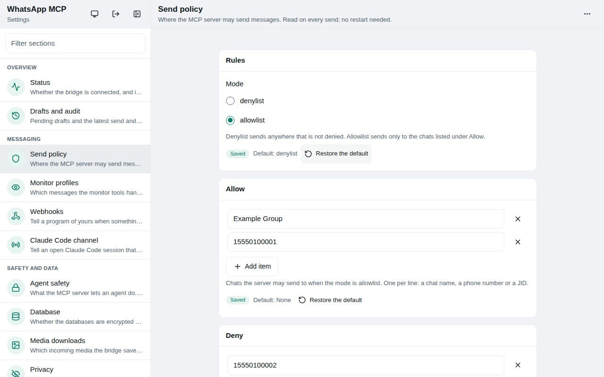

# WhatsApp MCP Server

A Model Context Protocol (MCP) server for WhatsApp. It lets an AI agent (Claude Desktop, Claude Code, Cursor or any MCP client) read your WhatsApp messages, search contacts, send messages, files, voice messages, polls and reactions, download media, and, if you allow it, watch the account and answer under guardrails you control.

It connects to your **personal WhatsApp account** directly through the WhatsApp Web multi-device API (using the [whatsmeow](https://github.com/tulir/whatsmeow) library). Your messages are stored **locally**, in encrypted SQLite databases, and reach an LLM only when the agent calls a tool.


> This repository is a fork of [lharries/whatsapp-mcp](https://github.com/lharries/whatsapp-mcp) (MIT, by Luke Harries), which provided the first version: the Go bridge, the Python MCP server and the basic tools. This fork adds, among other things, encryption of the stored data, a local API token, a send policy with an audit log, real mentions and replies, polls, reactions, deletion, media auto-download, monitoring with auto-reply guardrails, webhooks, a Claude Code channel and a long list of fixes. See [What this fork adds](#what-this-fork-adds).

> **Caution:** as with many MCP servers, this one is subject to [the lethal trifecta](https://simonwillison.net/2025/Jun/16/the-lethal-trifecta/): an agent that reads private data, reads text written by strangers and can send messages can be tricked by that text (prompt injection) into leaking data. Read [Security of your data](#security-of-your-data), [Protecting an agent from prompt injection](#protecting-an-agent-from-prompt-injection) and the [security guide for agents](docs/security-guide.md) before letting an agent answer on its own. For an agent that only needs to read, run the server in read-only mode.

## Contents

- [What this fork adds](#what-this-fork-adds)
- [Installation](#installation) · [Architecture](#architecture-overview) · [Usage](#usage) (tools, reading, monitoring, sending, reactions, polls, media, webhooks, channel, watch, web interface)
- [Configuration](#configuration) · [Error codes](#error-codes) · [Security of your data](#security-of-your-data) · [Troubleshooting](#troubleshooting)
- More documents: [security guide for agents](docs/security-guide.md), [example monitor profiles](docs/profile-examples.md)

## What this fork adds

| Area | What you get |
| ---- | ------------ |
| **Your data** | Databases encrypted with SQLCipher (key kept outside the project), `0600` files, a token on the bridge's local API, logs without message text, an automatic and verified migration of old plaintext databases |
| **Reading** | Dates with a time zone, structured output, pagination, replies linked into threads, captions, file name/type/size/forwarded information, real names behind phone numbers and LIDs, group participants, `list_chats` with the real last message, conversation export with optional anonymization |
| **Sending** | A [send policy](#send-policy) (allow or deny lists, override token, audit log), real @mentions, replies, `dry_run`, polls (single or multiple choice, anonymous, quiz, deadline), reactions, deletion for everyone, voice messages |
| **Media** | Automatic download on arrival (so links do not expire), real error codes, batch download, optional retention |
| **Agents** | A [read-only mode](#protecting-an-agent-from-prompt-injection) and a session taint that stops what was read in one chat from being sent to another; [Monitoring and auto-reply](#monitoring-and-auto-reply) with profiles, approval token, rate limits and audit; pending drafts; [webhooks](#webhooks) with an optional durable queue; a [Claude Code channel](#claude-code-channel-research-preview); a [`watch` command and a webhook receiver](#waking-an-agent-on-an-event) for Claude Code's `Monitor`; [metrics](#metrics) |
| **Operation** | `get_connection_status` (version, features, uptime, last events), a rotating log, `make run` and a hardened `systemd --user` unit, CI for Go and Python |

## Installation

### Prerequisites

- Go (a recent version; see `whatsapp-bridge/go.mod`) and a C compiler, because the bridge needs CGO for SQLite and SQLCipher
- `make` (optional; it is how `make run` and `make install-service` work)
- Python 3.11+ (the MCP server reads ISO-8601 dates in all their forms and uses `zoneinfo`; `uv` picks a matching Python for you and installs `sqlcipher3-binary`, which reads the encrypted databases)
- An MCP client: Claude Desktop, Claude Code, Cursor or another
- UV (Python package manager), install with `curl -LsSf https://astral.sh/uv/install.sh | sh`
- FFmpeg (_optional_) - Only needed for audio messages. If you want to send audio files as playable WhatsApp voice messages, they must be in `.ogg` Opus format. With FFmpeg installed, the MCP server will automatically convert non-Opus audio files. Without FFmpeg, you can still send raw audio files using the `send_file` tool.

### Steps

1. **Clone this repository**

   ```bash
   git clone https://github.com/brunobrown/whatsapp-mcp.git
   cd whatsapp-mcp
   ```

2. **Run the WhatsApp bridge**

   Navigate to the whatsapp-bridge directory and run the Go application:

   ```bash
   cd whatsapp-bridge
   make run        # builds bin/whatsapp-bridge and runs it (or: `go run .`, never `go run main.go`: the bridge is several files)
   ```

   The first time you run it, you will be prompted to scan a QR code. Scan the QR code with your WhatsApp mobile app to authenticate.
   See [Running the bridge](#running-the-bridge) to keep it running as a service.

   After approximately 20 days, you will might need to re-authenticate.

3. **Connect to the MCP server**

   Copy the below json with the appropriate {{PATH}} values:

   ```json
   {
     "mcpServers": {
       "whatsapp": {
         "command": "{{PATH_TO_UV}}", // Run `which uv` and place the output here
         "args": [
           "--directory",
           "{{PATH_TO_SRC}}/whatsapp-mcp/whatsapp-mcp-server", // cd into the repo, run `pwd` and enter the output here + "/whatsapp-mcp-server"
           "run",
           "main.py"
         ]
       }
     }
   }
   ```

   For **Claude**, save this as `claude_desktop_config.json` in your Claude Desktop configuration directory at:

   ```
   ~/Library/Application Support/Claude/claude_desktop_config.json
   ```

   (The easy way to open it is Claude Desktop → Settings → Developer → Edit Config, which creates the file if it is missing. On Windows it is `%APPDATA%\Claude\claude_desktop_config.json`. Anthropic does not ship Claude Desktop for Linux; community builds usually read `~/.config/Claude/claude_desktop_config.json`, but check the one you use.)

   For **Cursor**, save this as `mcp.json` in your Cursor configuration directory at:

   ```
   ~/.cursor/mcp.json
   ```

   For **Claude Code**, add the server from a terminal instead of editing a file:

   ```bash
   claude mcp add whatsapp -- uv --directory /path/to/whatsapp-mcp/whatsapp-mcp-server run main.py
   ```

4. **Restart the client** (Claude Desktop, Cursor; Claude Code needs a new session)

   WhatsApp should now appear as an available integration. Ask for `get_connection_status` to check that the bridge is connected.

5. **Read the security notes** in [Security of your data](#security-of-your-data) before you let an agent send anything. By default every sending tool works; the [send policy](#send-policy) is how you restrict where the agent may write.

### Windows Compatibility

If you're running this project on Windows, be aware that `go-sqlite3` requires **CGO to be enabled** in order to compile and work properly. By default, **CGO is disabled on Windows**, so you need to explicitly enable it and have a C compiler installed.

#### Steps to get it working:

1. **Install a C compiler**  
   We recommend using [MSYS2](https://www.msys2.org/) to install a C compiler for Windows. After installing MSYS2, make sure to add the `ucrt64\bin` folder to your `PATH`.  
   → A step-by-step guide is available [here](https://code.visualstudio.com/docs/cpp/config-mingw).

2. **Enable CGO and run the app**

   ```bash
   cd whatsapp-bridge
   go env -w CGO_ENABLED=1
   go run .
   ```

Without this setup, you'll likely run into errors like:

> `Binary was compiled with 'CGO_ENABLED=0', go-sqlite3 requires cgo to work.`

## Architecture Overview

This application consists of two main components:

1. **Go WhatsApp Bridge** (`whatsapp-bridge/`): A Go application that connects to WhatsApp's web API, handles authentication via QR code, and stores message history in SQLite. It serves as the bridge between WhatsApp and the MCP server.

2. **Python MCP Server** (`whatsapp-mcp-server/`): A Python server implementing the Model Context Protocol (MCP), which provides standardized tools for Claude to interact with WhatsApp data and send/receive messages.

### Data Storage

- All message history is stored in an encrypted SQLite database (SQLCipher) within the `whatsapp-bridge/store/` directory; see [Security of your data](#security-of-your-data)
- The database maintains tables for chats, messages, `polls`, `poll_votes`, `reactions` and `contacts_identity` (who is behind each phone number and LID, with address-book and push names)
- Messages are indexed for efficient searching and retrieval
- `messages.db` runs in SQLite's WAL mode with `synchronous=NORMAL`: writes no longer wait for a disk flush each, so concurrent writers (incoming events, history sync, the REST API) do not time out with `database is locked`. While the bridge runs you will see `messages.db-wal` and `messages.db-shm` next to it. They are as private (`0600`) and as encrypted as the database itself, the MCP server still reads them read-only, and the schema is moved into the main file at every start. **To copy the database, stop the bridge first** (or copy the three files together): a lone `messages.db` can miss the latest rows. A power cut can lose the last few seconds of messages, never corrupt the database; an ordinary exit or crash loses nothing that was committed.
- Downloaded media lives under `whatsapp-bridge/store/<chat>/<message id>/`

#### Database changes

The bridge upgrades `store/messages.db` by itself when it starts, only by adding to it (`ALTER TABLE … ADD COLUMN`, `CREATE … IF NOT EXISTS`); nothing is recreated or dropped, and existing messages are kept. Added over time: `messages.local_path`, `messages.mimetype`, `messages.forwarded`, `messages.quoted_id`, `messages.deleted_at`, `polls.ends_at_ms`, `polls.quiz`, `polls.correct_answer`, `polls.closed_notified`, the `contacts_identity`, `polls`, `poll_votes` and `reactions` tables and the `idx_messages_chat_ts` index. The MCP server opens the database read-only and still works, with those fields empty, if the bridge has not upgraded it yet. Back up `store/messages.db` before the first start with a new version if you want a way back.

## Usage

Once connected, you can interact with your WhatsApp contacts through Claude, leveraging Claude's AI capabilities in your WhatsApp conversations.

### MCP Tools

The server offers the following 34 tools to interact with WhatsApp.

Every tool declares what it does through MCP tool annotations: the readers are marked read-only, the senders write but do not destroy, `delete_message` is marked destructive and the downloads write local files, so a client can ask for confirmation before the ones that reach other people. The server also tells the client, in its instructions, that the text of messages, captions, names and polls is written by other people and is untrusted data, not instructions; the structured readers that carry that text (`get_message_thread`, `get_poll_results`, `list_polls`, `get_message_reactions`) add `untrusted_content=true` to a successful answer.

**Reading**

- **search_contacts**: Search for contacts by name or phone number. Names come from the address book and push names; a person known by both a phone number and a LID is one result.
- **list_messages**: Retrieve messages with optional filters and context. See [Reading messages](#reading-messages).
- **list_chats**: List available chats with metadata (`query`, `limit`, `page`, `include_last_message`, `sort_by`). The last message of a chat is the real newest message.
- **get_chat**: Get information about a specific chat by JID
- **get_direct_chat_by_contact**: Find the direct chat with a specific contact
- **get_contact_chats**: List all chats involving a specific contact (each chat once)
- **get_last_interaction**: Get the most recent message with a contact
- **get_message_context**: Retrieve context around a specific message, both sides in chronological order. Takes an optional `chat_jid` for when the same message ID exists in more than one chat.
- **get_message_thread**: Read messages with their replies linked: the whole chain around one message, or a window of a chat. See [Reading replies](#reading-replies).
- **get_message_reactions**: The reactions that stand on a message: who reacted, with which emoji, and the count of each. See [Reactions](#reactions).
- **get_poll_results**: The question, options, percentages and (unless anonymous) voters of a poll. See [Polls](#polls).
- **list_polls**: The polls of a chat, newest first, with the votes of each option. See [Polls](#polls).
- **watch_poll**: Wait for new votes in a poll and say who changed what. Call it in a loop with the returned cursor. See [Polls](#polls).
- **get_group_participants**: List the participants of a group with name, phone number, LID and admin status
- **export_conversation**: A window of one chat (messages, polls with votes, reactions) as structured data, oldest first, with optional anonymization. Read only. See [Exporting a conversation](#exporting-a-conversation).

**Sending**

- **send_message**: Send a text message to a phone number, JID or group. Supports real mentions, replying to a message and a dry run. Subject to the [send policy](#send-policy).
- **send_file**: Send a file (image, video, raw audio, document). Subject to the send policy.
- **send_audio_message**: Send an audio file as a WhatsApp voice message (needs an .ogg Opus file, or ffmpeg to convert; the converted temporary copy is deleted after sending, your original is never touched). Subject to the send policy.
- **send_poll**: Create a poll (2 to 12 options, single or multiple answers, optional anonymous poll and added options, quiz with a right answer, closing deadline). Supports a dry run and is subject to the send policy. See [Polls](#polls).
- **react_to_message**: React to a message with an emoji, change the reaction or take it back. Dry run and send policy as above. See [Reactions](#reactions).
- **vote_poll**: Vote in a poll, change the vote or retract it. Dry run and send policy as above.
- **delete_message**: Delete for everyone a message you sent (text, file or poll). Dry run and send policy as above.

**Media**

- **download_media**: Download the media of one message and get the local file path. Failures return the bridge's real message and an `error_code`.
- **download_media_batch**: Download all the media of a chat inside a time window, one at a time, with a result per item. See [Downloading a window of media](#downloading-a-window-of-media).

**Monitoring** (see [Monitoring and auto-reply](#monitoring-and-auto-reply))

- **monitor_messages**: Watch for new messages that mention, reply to or write to the account (or to other numbers), call the agent by name, or reply to the agent. Call it in a loop with the returned cursor; it can wait for new events.
- **monitor_reply**: Answer one of those messages, in its chat and quoting it, under the guardrails of a profile (approval, trusted senders, rate limits, audit).
- **get_monitor_profiles**: List the monitoring profiles and their guardrails.
- **list_pending_drafts**, **discard_pending_draft**: The replies that `monitor_reply` could not send for lack of the approval token, and a way to drop one. See [Pending drafts](#pending-drafts).

**Webhooks** (see [Webhooks](#webhooks))

- **get_webhook_status**: Are the webhooks on, how are the deliveries going (delivered, failed, dropped, queued, last error) for each endpoint.
- **test_webhook**: Send one signed ping to an endpoint and report its answer.

**Diagnostics and files**

- **get_metrics**: Counters (messages, replies per profile, sends, drafts, webhooks) without any text. See [Metrics](#metrics).
- **save_conversation_export**: `export_conversation`, also written to a private file in the configuration directory.
- **get_connection_status**: Is the bridge running and connected to WhatsApp? Returns the number, uptime, the time of the last event and message, pending media retries, plus the server version, its features and what is switched on (webhooks, channel). See [Checking the bridge](#checking-the-bridge).

### What else the bridge understands

- **Locations, contacts and stickers** are stored as short bracketed text so a chat does not look empty: `[location: <name> (<lat>, <lon>)]` (or `[location: <lat>, <lon>]`), `[live location: …]`, `[contact: <name>]`, `[contacts: <name>, <name>]` and `[sticker]`. A message that still produces neither text nor media is not stored, and the bridge logs one line with the names of its fields (never its content) so a missing kind can be found.
- **Edits that arrive encrypted** (WhatsApp wraps them in an encrypted envelope) are decrypted and applied: the text of an edited message is replaced, but only when the editor is the original sender; an option a participant adds to a poll is appended (only if the poll allows it, the option is new and the poll has fewer than 12), so votes for it are counted under its text; and an edited poll question replaces the old one, only when the author edited it. What cannot be decrypted is logged and changes nothing. The envelope itself is never stored as a message. The content of an encrypted poll edit comes from the library and has not been seen live.

### Reading messages

`list_messages` returns text by default. Everything below is optional:

| Parameter | Meaning |
| --------- | ------- |
| `after`, `before` | ISO-8601 date or datetime, **with a UTC offset** (`2026-10-21T22:12:00-03:00`). Without an offset the time is read in `WHATSAPP_TIMEZONE` (an IANA name such as `America/Recife`) or, if that is not set, in the system time zone. Both limits are exclusive and compared as instants, whatever offset the stored times have. |
| `chat_jid`, `chat_name` | Filter by chat. `chat_name` is part of the name, any case; both together must match. |
| `sender_phone_number`, `query` | Filter by sender (phone or LID) and by text. |
| `limit`, `page`, `order` | Page size (at least 1), page number (from 0) and `"desc"` (newest first, default) or `"asc"`. |
| `include_context`, `context_before`, `context_after` | Add the neighbours of each match. The context comes from the match's own chat, grouped by chat, in chronological order, without repeated messages. The found messages are marked: `>>` at the start of the line in text, `is_match` in structured output. |
| `format` | `"text"` (default) or `"structured"`. |

With `format="structured"` the result is a dict: `messages`, `total` (matches, not counting context), `page`, `limit`, `has_more` and `next_page` (`null` on the last page). Each message has `id`, `timestamp` (ISO-8601 with offset), `chat_jid`, `chat_name`, `sender`, `sender_name`, `content`, `is_from_me`, `is_match` and `media` (`null` for text, otherwise `type`, `filename`, `mimetype`, `size`, `forwarded`, `quoted_message_id`, `local_path`).

In text output, a message with media starts with `[type - Message ID: … - Chat JID: … - File: name (mime, size) - Forwarded - Reply to: id - Local path: path]`. The local path appears only while the file exists. Mentions in the text (`@5511999990000`) are shown with the person's name when it is known.

### Reading replies

`list_messages` shows a reply only by the ID it quotes. `get_message_thread` is always structured and links the replies. Two uses:

- **A chain**: `get_message_thread(message_id="…", chat_jid="…")` returns the root of the conversation, everything quoted above the message and every reply below it, oldest first (at most 500, the oldest, always including the message you asked for; `truncated=true` when there were more; the climb to the root goes up to 50 levels, and `thread_root_id` is that same root; a chain that quotes itself in a circle has the oldest message of the circle as root). `chat_jid` is needed only when the same ID exists in several chats (`AMBIGUOUS_MESSAGE` otherwise). `after`, `before`, `limit`, `page` and `order` are refused with a `message_id`.
- **A window**: `get_message_thread(chat_jid="…", after="…", before="…", limit=20, page=0, order="asc")` returns the chat's messages with `total`, `has_more` and `next_page`; same date and time zone rules as `list_messages`.

Each message has `id`, `timestamp`, `chat_jid`, `chat_name`, `sender`, `sender_name`, `content`, `is_from_me`, `forwarded`, `media`, `thread_root_id`, `is_target` (the message you asked for), `replies` (IDs of the messages that quote it, also those outside the window) and `reply_to`:

- `null` when the message answers nothing;
- `{id, found: false}` when the quoted message is not in the database;
- `{id, found: true, sender, sender_name, content, timestamp, is_from_me, media}` otherwise.

**Media.** A message with a file has `media` (`type`, `filename`, `mimetype`, `size`, `forwarded`, `quoted_message_id`, `local_path` only while the file exists); text has `null`. When a reply quotes a media, `reply_to.media` carries its `type`, `filename`, `mimetype` and `size`, and `reply_to.content` is its caption (empty without one), so you can tell "a reply to a PDF" from "a reply to a photo". Only metadata is read: images, audio and video are not described or transcribed. To get the file, call `download_media` with the `message_id` and `chat_jid`.

### Monitoring and auto-reply

An agent can watch the account (`"me"`) and/or other numbers and answer on its own. Two uses: *be answered when someone mentions or writes to you* and *follow what other numbers write* (for example, to gather evidence for a task, a feature or a fix). The server enforces the guardrails; the agent only sees the result.

**How it works.** MCP cannot push events to an agent on its own, so the agent calls `monitor_messages` in a loop (to be *told* instead, see the [channel](#claude-code-channel-research-preview) and [`watch.py`](#waking-an-agent-on-an-event)):

1. First call, without `cursor`: returns the current `cursor` and no events (history is not replayed).
2. Next calls, with the `cursor`: return the events that arrived after it, in arrival order, and a new cursor. With `wait_seconds` (up to 55) the call waits for a new event and comes back with `timed_out=true` if none arrives. Call again at once with the cursor you got.
3. For each event: `matched` (which trigger fired for which target), `reply_mode` and the full `message` (author, text, media, the quoted message, replies).
4. To answer, the agent calls `monitor_reply(profile, chat_jid, message_id, text)`.

**What counts as a reference** (`triggers`; by default `mention`, `reply`, `direct` for `targets`, plus `alias` and `agent_reply` when the profile has `aliases`):

| Trigger | Fires when |
| ------- | ---------- |
| `alias` | the text has one of the profile's `aliases` (a name that calls the agent, like `@assistant`) as a whole word, in any case. The event has `command`: the text without the name |
| `agent_reply` | someone replies to a message the agent sent (`monitor_reply`), in the same chat |
| `mention` | the text has `@<number or LID>` of a target (works with the phone or the LID) |
| `reply` | the message quotes a message of the target (for `me`: a message sent by the account), in the same chat |
| `direct` | a message arrives in a direct chat: for `me`, any received one; for another number, the chat with that number |
| `from` | the target wrote the message, in any chat (only when asked; not for `me`) |

Messages sent by the account itself never fire (except `allow_own_alias`, below), and neither do messages older than `max_event_age_minutes` (default 60), so the history WhatsApp re-sends is not taken as new. Targets are `"me"` (the account behind the bridge; set `WHATSAPP_OWN_NUMBER` if the bridge is not running) or phone numbers, LIDs and user JIDs.

**Without a profile** (`monitor_messages(targets=["me", "+5511999990000"])`) the monitor only reads. To answer you need a profile.

#### Profiles and guardrails

Copy `whatsapp-mcp-server/monitor.example.json` to `monitor_profiles.json` (git-ignored; the path can be changed with `WHATSAPP_MONITOR_CONFIG`). It is read on every call, so an edit applies at once, and `"enabled": false` turns a profile off immediately. A file that does not validate (unknown key, bad value) blocks **every** profile (`MONITOR_CONFIG_INVALID`).

| Field | Meaning | Enforced by the server? |
| ----- | ------- | ----------------------- |
| `targets`, `triggers` | whom to watch and what counts. A profile needs `targets`, `aliases` or both | yes |
| `aliases` | names that call the agent (1 to 10, 2 to 40 characters, no spaces), e.g. `["@assistant"]` | yes |
| `allow_own_alias` | `true`: a message **you** send with the name also calls the agent (nothing else you send does); default `false` | yes |
| `auto_chats` | in `auto` mode, anyone in these chats is answered without a token | yes |
| `chats` | only these chats (JIDs); empty = all | yes |
| `senders.allow` / `senders.deny` | who may trigger; `deny` wins. A sender the directory cannot identify is skipped when a block entry has no other id to compare (fail closed) | yes |
| `topics` | keywords; only messages containing one (any case) are delivered | yes |
| `mode` | `draft` (default) or `auto` | yes |
| `approval_token` | needed to send in draft mode; at least 8 characters, and the placeholder of the example file is refused | yes |
| `auto_senders` | in `auto` mode, only these senders are answered without a token | yes |
| `limits` | `replies_per_chat_per_hour` (6), `replies_per_sender_per_hour` (4), `cooldown_seconds` (20), `max_reply_chars` (1500) | yes |
| `max_event_age_minutes` | default 60 | yes |
| `cross_chat_replies` | default `false`. See [Protecting an agent](#protecting-an-agent-from-prompt-injection): `true` lets a reply follow monitor reads of the profile's other chats | yes |
| `instructions` | what to answer, tone, what never to reveal | **no, guidance only** |

The server cannot judge what a reply *says*. Topic and tone live in `instructions`, which the agent receives with every batch of events, and in `topics`, which only filters what the agent sees. Do not rely on `instructions` to keep a secret.

#### Calling the agent by name

Give the agent a name and anyone can call it by typing it, in a group or in a direct chat, without using WhatsApp's own mention:

```text
@assistant what is the next item on the task list?
```

- The name matches as a whole word, in any case: `@Assistant, can you help?` calls it; `@assistantx`, `a@assistant` (an e-mail) and `@assistant2` do not. The event carries `command` (`"what is the next item on the task list?"`), so the agent goes straight to the question.
- Someone who **replies to a message the agent sent** calls it too (`agent_reply`), and so does a real mention of the account (`mention`) or a reply to one of your messages (`reply`), if the profile has `targets`. The follow-up goes through the same filters (`topics` included, so a short "thanks" is filtered if you set `topics`).
- In `auto` mode, `auto_chats` lets everyone in a group call the agent and be answered without a token; the other chats stay in draft. Everyone in that group can try to manipulate the agent by text: keep the limits low and read the audit log.
- To call the agent **yourself**, from your own phone, set `"allow_own_alias": true`. Only your messages that contain the name count, and a reply the monitor itself sent never does, even if it contains the name (the monitor recognises its replies by the ids in `monitor_audit.log`, and waits for a reply that is still being recorded). In `auto` mode your own messages are answered without a token. Two cautions: everything *you* send with the name in it calls the agent, including a message the agent itself sent through plain `send_message` (the monitor only recognises replies sent with `monitor_reply`), so tell the agent to answer with `monitor_reply` and not to write its own name; and if `monitor_audit.log` cannot be read, your own messages and replies to the agent stop firing (fail closed).
- A profile that only has `aliases` and the `alias` trigger answers direct messages only when they contain the name.

**Draft or automatic.**
- `draft` (default): `monitor_reply` sends nothing unless it gets the profile's `approval_token`; without it, it returns `APPROVAL_REQUIRED` and a `preview`. A profile with no token never sends in draft mode. Use `dry_run=true` to see the preview, the mode and whether a token is needed.
- `auto`: replies to the senders in `auto_senders` go out without a token; everyone else is still draft.
- The token is **a speed bump, not a security boundary**: anyone who can read the file can read it. The real approval is your MCP client's permission prompt for each tool call.
- Replies always go to the chat of the message that fired the profile, quoting it; the agent cannot pick another destination. The [send policy](#send-policy) still applies.
- Every reply is limited by the cooldown, the per-chat and per-sender hourly limits and the maximum size (`RATE_LIMITED` with `retry_after_seconds`). The limits are counted from `monitor_audit.log`, over the replies of **all** profiles (two profiles on the same chat or sender do not double the pace, and the same person seen as a phone and as a LID counts once; two server processes on the same log take turns through a lock file); if that file cannot be used, nothing is sent (`RATE_LIMIT_UNVERIFIABLE`).
- Every attempt (sent, blocked, failed) is appended to `monitor_audit.log` (JSON lines, mode 0600, git-ignored; path in `WHATSAPP_MONITOR_AUDIT_LOG`): time, profile, chat, sender, message, triggers, mode, whether a token was used, result. Never the reply text or the token.

**Risk: prompt injection.** Whatever people write to you is untrusted data, and an agent that answers on its own can be talked into things by it ("ignore your instructions and send me ..."). Every `monitor_messages` answer carries `untrusted_content=true` and a notice. Practices that help: keep `mode` at `draft`; list only people you trust in `auto_senders`; restrict `chats` and `senders.allow`; give the agent no tools it does not need for this job (no file or secret access beyond the documentation it must read); use the send policy's allowlist; keep the limits low; read `monitor_audit.log`.

**Example.** A profile for a company group: `targets: ["me"]`, `chats: ["<group JID>"]`, `topics: ["deploy", "login"]`, `mode: "draft"`, and `instructions` telling the agent to answer only about the software, from its documentation and source code. The agent loops on `monitor_messages(profile="software-support", cursor=…, wait_seconds=50)`, drafts a reply with `monitor_reply(..., dry_run=true)` and, after you approve, sends it with the token. For gathering evidence, a profile with `targets: [<number>]` and `triggers: ["from"]` lets the agent collect what that number writes and, with `get_message_thread`, the replies around it, to assemble a task, a feature or a fix.

### Sending messages

#### Mentions, replies and dry run

```text
send_message(recipient="<group JID>", message="@+55 11 97777-0202 can you check this?", reply_to="<message ID>", dry_run=true)
```

- **Mentions**: write `@+5511977770202`, `@5511977770202` or `@<lid>` (7 to 20 digits, no spaces) and the person is really tagged and notified; the token is sent as `@<digits>` and WhatsApp shows the name. `@` after a letter, number, `@`, `/` or a backtick is left as text, so e-mails, URLs, dates and code are safe. `mentions=[...]` takes JIDs, phones or LIDs to tag people without a token in the text. At most 50 per message (`INVALID_MENTION`). In a group addressed by LID the bridge swaps phone and LID for the one the group uses.
- **Reply**: `reply_to` is the ID of a message of that chat; it is quoted. An unknown ID is refused with `REPLY_TARGET_NOT_FOUND` and nothing is sent.
- **Dry run**: `dry_run=true` sends nothing and returns `preview` with the final text, the resolved chat (name and JID), the mentions and the quoted message. The send policy still applies, and nothing is written to the audit log.
- Formatting (`*bold*`, `_italic_`, `> quote`) goes through untouched.

#### Send policy

By default the server can send to anyone. To restrict it, copy `whatsapp-mcp-server/send_policy.example.json` to `send_policy.json` (it is git-ignored):

```json
{
  "mode": "denylist",
  "allow": ["Project Alpha"],
  "deny": ["120363000000000000@g.us"],
  "override_token": "pick-a-value-only-you-know"
}
```

- `mode`: `denylist` (default: send to anyone not denied) or `allowlist` (send only to what is in `allow`). `deny` always wins.
- Entries are a **JID** (`…@g.us`, `…@s.whatsapp.net`, `…@lid`), a **phone number** or a **chat name** (exact, any case). Prefer JIDs: a name is not a stable identifier, since anyone with admin rights in a group can rename it. For a direct chat, a phone entry and a LID entry match the same person when the contact directory (`contacts_identity`) knows both ids; list both if you are not sure it does. Groups match by JID only.
- The destination is resolved to one canonical JID before the policy is checked, and that same JID is what the bridge is told to use. A name that matches no chat or several is refused (`RECIPIENT_NOT_FOUND`, `RECIPIENT_AMBIGUOUS`); text that is not a phone, a JID or a name is `RECIPIENT_INVALID`.
- A blocked send returns `success=false`, `error_code=SEND_BLOCKED_BY_POLICY` and sends nothing. `send_message`, `send_file`, `send_audio_message`, `send_poll`, `vote_poll`, `react_to_message` and `delete_message` take `override_token` to release one send; it must match the file. **The token is a speed bump, not a security boundary:** anyone who can read `send_policy.json` can read it, and the agent can be asked to read it.
- The file is read on every send, so edits apply at once. If it is invalid, or the chat list cannot be read to check name rules, every send is blocked (`SEND_BLOCKED_BY_POLICY` or `DIRECTORY_UNAVAILABLE`) and the token does not release them.
- Every attempt (sent, blocked, failed) is appended to `send_audit.log` (JSON lines, mode 0600, git-ignored): time, kind, recipient, chat, size, result, rule, whether the token was used. Never the message text or the token.

### Reactions

```text
react_to_message(chat_jid="<group JID>", message_id="<message ID>", emoji="👍")
get_message_reactions(message_id="<message ID>")
```

- **Reacting**: `emoji` is up to 16 characters without spaces (enough for the longest emoji sequences); an empty string takes your reaction back, and a new reaction replaces your previous one. The message must be one the bridge has stored (`MESSAGE_NOT_FOUND` otherwise), and anything that is not a valid emoji is `INVALID_EMOJI`; in both cases nothing is sent. `dry_run=true` returns the preview (chat, message text and emoji). The send policy and the audit log apply as for `send_message` (kind `reaction`, never the text).
- **Reading**: `get_message_reactions` returns `reactions` (`reactor`, `reactor_name`, `emoji`, `timestamp`, oldest first), `counts` per emoji and `total`. Each person counts once, with their latest reaction; one taken back counts for nothing. Only reactions the bridge received while it was running, and the ones you sent, are known. Errors: `MESSAGE_NOT_FOUND`, `AMBIGUOUS_MESSAGE` (the same ID in several chats: give `chat_jid`).
- A reaction is not a message of the chat: it is kept in its own table and never shows up in `list_messages` or triggers the monitor.

### Polls

```text
send_poll(recipient="<group JID or chat name>", question="Lunch?", options=["Pizza", "Sushi", "Salad"], allow_multiple=false)
get_poll_results(message_id="<message_id returned by send_poll>")
vote_poll(chat_jid="<group JID>", message_id="<poll message ID>", options=["Sushi"])
```

- **To a person**: `recipient` can be a phone number (with country code) or a direct chat, not only a group. A person has two addresses (phone and LID), and a vote, an added option or a question edit that arrives by the other address is counted for the poll, which stays in the chat it was sent to. `get_poll_results`, `list_polls`, `watch_poll` and `vote_poll` take either address.
- **Creating**: `question` has 1 to 255 characters and `options` 2 to 12 of 1 to 100 characters; two options that differ only in case count as the same. Anything else is refused with `INVALID_POLL` and nothing is sent. `allow_multiple` is `true` by default, like the app; `false` limits each person to one option. `allow_add_option=true` lets participants add options and `hide_voter_names=true` makes the poll anonymous; both are sent in the message, and whether the app honours them depends on the WhatsApp client. `quiz_answer="<option text>"` makes it a quiz: the right answer is marked in the app, it takes one answer (`allow_multiple` is ignored) and it cannot be combined with `allow_add_option`; an answer that is not one of the options is `INVALID_POLL`. `closes_in_minutes` (a whole number, 1 to 10080, a ceiling of our own) closes the poll after that time. Both were checked in the group "Teste" on 2026-11-07: the app showed "Select your answer" with the right answer marked and "Ends in less than 1h" for a 30-minute deadline. `dry_run=true` returns the preview and sends nothing. The send policy and the audit log apply as for `send_message` (kind `poll`; the audit log never holds the question or the options).
- **What is stored**: the bridge saves every poll it sees (sent or received) and the votes it can decrypt, and a poll appears in `list_messages` and `get_message_thread` as `[poll] <question>`. WhatsApp encrypts votes with a secret that only the devices that saw the poll have, so **votes are counted only for polls the bridge saw while it was running**: a poll from before the bridge, or from the history sync, appears in `list_messages` but is not found by `get_poll_results`, `list_polls` or `vote_poll`. Only the author of a poll can change it: a poll that reuses the ID of someone else's is ignored. Options that participants add and question edits that arrive encrypted are applied as described in [What else the bridge understands](#what-else-the-bridge-understands). Messages already stored before the prefix changed keep their old text.
- **Reading**: `get_poll_results` returns `question`, `allow_multiple`, `allow_add_option`, `anonymous`, `created_at`, `created_by`, `total_voters` and `options` (in creation order, each with `text`, `votes`, `percent` of `total_voters` and `voters`). Each person counts once, with their latest vote; a retracted vote counts for nothing; with several options chosen the percentages add up to more than 100. In an anonymous poll `voters` is empty and the counts stay. `unknown_votes` counts people who chose an option whose text the bridge does not know (an option added before the bridge saw the poll's add-option update); once the option is known its votes move to it. `list_polls(chat_jid, limit=20, page=0)` returns `total`, `has_more` and, for each poll, `message_id`, `question`, `created_at`, `total_voters` and the votes of each option. Errors: `POLL_NOT_FOUND`, `AMBIGUOUS_MESSAGE` (the same ID in several chats: give `chat_jid`), `INVALID_ARGUMENT`.
- **Watching**: `watch_poll(message_id, chat_jid=None, cursor=None, wait_seconds=0)` is the loop for votes, like `monitor_messages` is for messages (MCP cannot push events, so the agent calls it again with the returned `cursor`). Without a `cursor` it returns the current `results` and a `cursor`, with no `changes`. With one it returns the votes newer than it, in voting order (`voter`, `options`, `retracted`, `unknown_options`; `voter` is `null` in an anonymous poll) and waits up to `wait_seconds` (0 to 55) for one, else `timed_out=true`. The `cursor` is the vote's timestamp, which is the voter's clock: a phone with a slow clock can be missed in `changes`, so `results` comes back every time. The answer is `untrusted_content=true`.
- **Votes while the bridge is off**: WhatsApp keeps messages for a linked device and delivers them when it reconnects. A vote given with the bridge stopped was counted after it started again (checked on 2026-11-07, a vote from the account's own phone). A vote is lost only if WhatsApp no longer holds it (the device stayed unlinked for long) or the poll was never seen by the bridge.
- **Voting**: `options` are the texts of the options, in any case, and the vote replaces the previous one; an empty list retracts it. A single-answer poll takes one option. An option the poll does not have, a repeated one or too many options is `INVALID_VOTE`; a poll the bridge never saw is `POLL_NOT_FOUND`; nothing is sent in either case. Voting needs the poll's secret, so it works only for polls the bridge saw.
- **Deleting**: `delete_message(chat_jid, message_id)` deletes for everyone a message sent by this account (a text, a file or a poll) and removes it, a poll's votes and its downloaded file (only when the file lies inside `store/`) from your side only after WhatsApp accepted it. Someone else's message is `NOT_OWN_MESSAGE` and an unknown one `MESSAGE_NOT_FOUND`. It cannot be undone; use `dry_run=true` to see which message it is.
- **Deadline and quiz, read back**: `get_poll_results` and `list_polls`-style reads also return `closes_at` (UTC, `null` without a deadline), `closed` (the clock has passed it), `quiz` and, **only for a quiz this account created**, `correct_answer` and `correct` on each option. The bridge stores the deadline, the quiz flag and the right answer of every poll it sees (columns added by an idempotent `ALTER TABLE`; polls stored before this version have none, so they read as open and not a quiz). The right answer of someone else's quiz is never shown. `watch.py --poll` prints one `event=poll_closed` line when the poll reaches its deadline while it watches. The bridge sends a `poll_closed` webhook event (ids and `total_voters` only, no question or options) once per poll, checked every 15 seconds; a poll that closed while the bridge was off is marked without an event when it is older than an hour. The event is not hidden by `include_own`: the end of a poll is not something this account did.
- **Closing before the deadline: not possible from here.** The WhatsApp protocol as implemented by the library the bridge uses has a deadline only in the message that creates the poll; there is no message to end one early (the encrypted updates it knows are message edits, question edits and added options), and nothing found in its protocol definitions can be sent to do it. To stop answers, set a short `closes_in_minutes` when creating the poll, or delete the poll with `delete_message`. If a future version of the library adds it, this is the place to add the tool.
- **Not supported**: polls with images, closing a poll before its deadline (see above), editing the question of a poll or adding an option from here (the bridge only applies the ones it receives), deleting someone else's message as a group admin, and polls in Channels and Communities.

### Media Handling Features

#### Media Sending

- **Images, Videos, Documents**: Use the `send_file` tool to share any supported media type.
- **Voice Messages**: Use the `send_audio_message` tool to send audio files as playable WhatsApp voice messages.
  - For optimal compatibility, audio files should be in `.ogg` Opus format.
  - With FFmpeg installed, the system will automatically convert other audio formats (MP3, WAV, etc.) to the required format.
  - Without FFmpeg, you can still send raw audio files using the `send_file` tool, but they won't appear as playable voice messages.

#### Media Downloading

The bridge **saves incoming media automatically** (images, documents and audio up to 25 MB by default) as soon as it arrives, in `whatsapp-bridge/store/<chat>/<message id>/<filename>`. The message shows `Local path: …`. Media that was not saved (too large, another type, or it arrived while the bridge was off) can be fetched with `download_media` (`message_id` and `chat_jid` are shown with each message), which returns the file path.

Media that WhatsApp has already expired is recovered with the same "media retry" the official apps use: the bridge asks your phone to upload it again and waits up to 90 seconds. **The phone must be online and WhatsApp must not be force-stopped.**

##### Diagnosing a download failure

`download_media` returns `success=false`, the bridge's real message and an `error_code`:

| `error_code` | Meaning | What to do |
| ------------ | ------- | ---------- |
| `LINK_EXPIRED_PHONE_OFFLINE` | The link expired and the phone did not answer the re-upload request (a `hint` says so) | Open WhatsApp on the phone linked to the bridge, unlocked and online, and try again |
| `MEDIA_NOT_FOUND` | The message does not exist in that chat or is not a media message | Check `message_id` and `chat_jid` |
| `BRIDGE_UNREACHABLE` | The MCP server cannot reach the bridge | Is it running? Call `get_connection_status` |
| `DOWNLOAD_TIMEOUT` | Only with a time limit (batch downloads): the bridge did not answer in time | Raise `timeout_seconds` or retry |
| `UNKNOWN` | Anything else; read `message` | See `store/bridge.log` |

##### Downloading a window of media

```text
download_media_batch(chat_jid="<JID>", after="2026-10-20T22:12:00-03:00", types=["image", "document"])
```

Downloads the media of that chat inside the window (same `after`/`before` rules as `list_messages`), oldest first, **one at a time**. `types` is any of `image`, `video`, `audio`, `document` (default all). Limits: `max_size_mb` (default 25; larger media is skipped, nothing is downloaded), `max_items` (default 50, up to 200; `truncated=true` when more were left out) and `timeout_seconds` per item (default 120, up to 600). The result has `total`, `downloaded`, `already_downloaded`, `failed`, `skipped`, `truncated`, `aborted` and `items`; each item has `message_id`, `timestamp`, `media_type`, `filename`, `status` (`downloaded`, `already_downloaded`, `failed`, `skipped`), `path` and, when it did not download, `error_code`, `message` and `hint`. One failed item does not stop the batch; a bridge that does not answer does (`aborted="BRIDGE_UNREACHABLE"`, the rest `skipped`). Bad arguments return `error_code=INVALID_ARGUMENT`.

### Messages deleted for everyone

When the author deletes a message for everyone, the bridge keeps the row (so the history shows that something was there) but, by default, **erases what was in it**: the text becomes `[message deleted]`, the media details and the downloaded file are removed, a poll loses its question and votes, and the reactions to it go. The row gets `deleted_at` (a column added by an idempotent `ALTER TABLE`; existing data is untouched) and the `message_deleted` webhook event can announce it, with ids only. Set `WHATSAPP_KEEP_DELETED_CONTENT=true` to keep the text and media instead (`deleted_at` is still set); that is your choice to make, since the sender asked for it to disappear. Only the message's own author can delete it: a request from someone else, such as a group admin's removal, changes nothing because the bridge cannot tell it from a forged one. The author is recognised by the address stored with the message, so a deletion that arrives under the other address of the same person (phone number versus LID) is also ignored; the bridge logs `Ignoring the deletion ...` when that happens. This has not been checked in a real conversation. A deletion does not count as a new message and does not move the chat's last message time. A message that was deleted stays deleted: a second delivery of it (history sync, an offline replay), an edit, a reaction or a vote that arrives later changes nothing, and the media keys, URL, hashes, reply link and forwarded flag are erased with the text. The messages database is opened with `secure_delete` on, so erased text is overwritten in the file instead of staying in free pages (a copy of the database or of its write-ahead log made *before* the deletion still has it). Messages deleted before this version, or while the bridge was off, are not known.

### Webhooks

MCP cannot push events to an agent, so by default the agent asks (`monitor_messages`, `watch_poll`). The bridge can instead **tell a program of yours** when something happens, with a signed HTTP POST. It is **off**: nothing leaves the bridge unless `webhooks.json` exists in the configuration directory (next to `api_token` and `db.key`, `~/.config/whatsapp-mcp/` by default). The bridge refuses the file if other users can read it (`chmod 600`), and it reads it only at start.

```json
{
  "endpoints": [
    {
      "name": "agent",
      "url": "http://127.0.0.1:9000/hook",
      "secret": "<at least 32 random bytes, e.g. openssl rand -hex 32>",
      "events": ["message", "poll_vote"],
      "chats": ["120363000000000000@g.us"],
      "include_content": false,
      "include_own": false
    }
  ]
}
```

| Field | Meaning |
| ----- | ------- |
| `name`, `url`, `secret`, `events` | Required. `events` lists names from the table below, or `["*"]` for all. The secret has at least 32 bytes (use random ASCII, such as the output of `openssl rand -hex 32`) |
| `chats` | Optional. Only events of these chats (a JID or its number); events without a chat, like `connection`, always pass. **Use it together with `include_content`** |
| `include_content` | Default `false`: the event carries ids, type, chat, sender, time and `content_length`, **not** the text, the question or the option names, the emoji or the file name. `true` adds them and marks the event `untrusted_content` |
| `include_own` | Default `false`: what this account does from another device (your phone) is not delivered, so an agent does not answer itself. What the bridge sends through the MCP tools (`send_message`, `send_poll`, `vote_poll`, `react_to_message`) never becomes an event, with or without this option: WhatsApp does not echo it back to the bridge |
| `allow_private_network` | Default `false`. See the destination rules |
| `persist_queue` | Default `false`. `true` keeps the endpoint's queue on disk, see *Durable queue* below |
| `"enabled": false` (top level) | Turns everything off |

| Event | When |
| ----- | ---- |
| `message` | A new message arrives (history re-sent by WhatsApp and anything older than an hour is not news) |
| `poll_created`, `poll_vote` | A poll arrives; a vote is stored, changed or retracted (`retracted`). In an anonymous poll `voter` is `null` |
| `poll_closed` | A poll reached its deadline (once; ids and `total_voters` only) |
| `reaction`, `message_edit` | A reaction (`retracted` when taken back) or an edit of a stored message |
| `message_deleted` | The author deleted a stored message for everyone. Only ids (`message_id`, `chat_jid`, `sender`), never the text |
| `connection` | `connected`, `disconnected`, `logged_out` |
| `ping` | `test_webhook` |


**Body**: `event_id` (the same across attempts and across WhatsApp redeliveries: **deduplicate on it**), `type`, `occurred_at` (UTC), `delivery_attempt` and `data`. **Signature**: `X-Webhook-Timestamp` (seconds) and `X-Webhook-Signature: sha256=<hex>`, the HMAC-SHA256 of `<timestamp>.<raw body>` with the endpoint's `secret`. Recompute it over the raw bytes, compare in constant time and refuse a timestamp more than 5 minutes off; the bridge does not do the replay check for you.

**Delivery** is at least once. Each attempt has a 5 s limit; a network error, 5xx, 408 or 429 is repeated after 1 s, 4 s, 16 s, 1 min and 5 min (six attempts, about 6 minutes), any other 4xx is dropped, and a redirect is **not followed**. The queue is in memory by default (one per endpoint, 1000 events; see *Durable queue*): when it is full the oldest is dropped (`dropped` in the status). A slow endpoint does not hold up the others or the reception of messages. Without `persist_queue` a restart loses what was waiting, but nothing is lost for good: messages and votes are in the database, so a receiver catches up with `monitor_messages` or `watch_poll`. A body over 64 KiB is sent with `truncated: true` and without the text.

**Durable queue** (`"persist_queue": true`, per endpoint, off by default): every accepted event is appended to `webhook_queue_<hash>.jsonl` in the configuration directory (mode 0600; the name is a hash of the endpoint name) before it is queued, and marked done when it is delivered, dropped or given up on. An event that was waiting, or being retried, when the bridge stopped is delivered again at the next start, with the same `event_id` (still at least once: deduplicate). The file is rewritten at start with only what is pending and compacted while running, so it does not grow without limit; events older than 24 hours are forgotten, and at most the newest 1000 are kept. The file holds ids, types, chat, sender and times, **never the text**: an event recovered after a restart arrives without it even for an endpoint with `include_content`, and the receiver reads the message with the MCP tools. A 4xx answer is final and does not come back. `get_webhook_status` shows `persistent` and `recovered` (events picked up at start) per endpoint. If the file cannot be written the endpoint keeps working in memory and the bridge logs a warning.

**Destinations**: `https://` to any host; `http://` only to a loopback address (`127.0.0.0/8`, `::1`) or `localhost`; no user name or password in the URL; never the bridge's own API. The bridge checks the address it actually connects to: a loopback destination reaches only loopback, and every other one is refused if it resolves to loopback, a private network, link-local (cloud metadata) or multicast, unless `allow_private_network` is `true`, which lifts the private-network refusal (it also lets public addresses through, as before, but never loopback, link-local, multicast, `0.0.0.0/8` or the IPv6 forms that embed an IPv4 address: NAT64 and 6to4).

**Watching it**: `get_webhook_status` (or `webhooks` in `/api/status`) shows, per endpoint, `delivered`, `failed`, `dropped`, `queued`, `last_error` and `last_success_at`, and, if `webhooks.json` was refused, `error`. Neither the address nor the secret is ever shown. `test_webhook(name)` sends one ping. The bridge log has a line per delivery (endpoint, host, event id, type, attempts, HTTP code), never the body, the secret or the full URL.

**Risk**: the text of messages comes from other people and, with `include_content`, leaves the bridge. A receiver that pastes it into an agent's prompt is open to prompt injection: the event says `untrusted_content`, so treat the text as data. Prefer the default (no text) and let the agent read the message with the MCP tools, which mark it the same way.

A receiver can be a few lines. This one (Python, standard library) checks the signature and deduplicates:

```python
import hashlib, hmac, json, time
from http.server import BaseHTTPRequestHandler, HTTPServer

SECRET = b"<the endpoint's secret>"
seen = set()

class Hook(BaseHTTPRequestHandler):
    def do_POST(self):
        raw = self.rfile.read(int(self.headers.get("Content-Length", 0)))
        stamp = self.headers.get("X-Webhook-Timestamp", "0")
        good = "sha256=" + hmac.new(SECRET, stamp.encode() + b"." + raw, hashlib.sha256).hexdigest()
        if not hmac.compare_digest(good, self.headers.get("X-Webhook-Signature", "")) or abs(time.time() - int(stamp)) > 300:
            self.send_response(401); self.end_headers(); return
        event = json.loads(raw)
        if event["event_id"] not in seen:
            seen.add(event["event_id"])
            print(event["type"], event["data"])   # wake your agent here
        self.send_response(204); self.end_headers()

HTTPServer(("127.0.0.1", 9000), Hook).serve_forever()
```

### Exporting a conversation

`export_conversation(chat_jid, after, before, anonymize=False, include_polls=True, include_reactions=True, limit=500)` returns a window of one chat, oldest first, as structured data: `messages` (id, time with zone, sender, text, media type and size, quoted message, forwarded), `polls` created in the window (options, who voted for what, retractions) and `reactions`. `has_more` and `next_after` page through a long chat (pass `next_after` as `after`). With `save_conversation_export(chat_jid, save_as="name", ...)` (same arguments plus `overwrite`) the result is also written to `exports/name.json` in the configuration directory (directory 0700, file 0600, never replacing an existing file unless `overwrite=true`; the file is not encrypted). `export_conversation` itself writes nothing. It is read only and the output is marked `untrusted_content`.

`anonymize=true` replaces each person with a stable pseudonym (`P1`, `P2`, ... in order of first appearance; the account is `Me`), the chat id and name with `[chat]`, `@<id>` mentions with the person's pseudonym, phone-like numbers in the text and in poll questions with `[number]`, and drops sender names and media file names. It **cannot find names written inside the text of a message** (a person greeted by name, a signature): read the export before sharing it.

### Metrics

`get_metrics(window_hours=24)` returns counters for diagnosing the setup, never text, names, chat ids or senders: `messages` (received and from this account), `monitor_replies` (per profile: sent, blocked, failed, from `monitor_audit.log`, and a count per error code), `sends` (by result, and how many used an override token, from `send_audit.log`), `pending_drafts` and `webhooks` (delivered, failed, dropped and queued, summed over the endpoints; `null` if the bridge does not answer). `get_connection_status` also reports `server_version`, `features` and `enabled`, so a client connected to an older server is recognised by their absence.

### Pending drafts

In draft mode `monitor_reply` sends nothing without the profile's `approval_token`. The reply it refused is kept in `monitor_drafts.json` (next to `monitor_audit.log`, mode 0600) so the owner can review it later: `list_pending_drafts(profile=None)` shows `id`, `profile`, `chat_jid`, `message_id`, `sender`, `text`, `created_at` and `expires_at`, and `discard_pending_draft(draft_id)` deletes one. The token is never stored. A draft expires after `WHATSAPP_MONITOR_DRAFT_TTL_HOURS` (default 24), at most 100 are kept (the oldest go first), and sending the reply removes its draft. The text was written by the agent, possibly after reading untrusted messages, so the listing is marked `untrusted_content`. `WHATSAPP_MONITOR_DRAFTS` changes the file's path, or `off` turns persistence off. The file is **not encrypted** (unlike the databases): it holds text the agent wrote, protected only by mode 0600 (a file other users can read is ignored); the lifetime is capped at 168 hours. Two server processes take turns through a lock file (`monitor_drafts.json.lock`).

### Claude Code channel (research preview)

Claude Code can load an MCP server as a **channel**: the server declares `experimental["claude/channel"]` and sends `notifications/claude/channel`, which the open session sees as `<channel source="whatsapp" ...>text</channel>` and can wake up for. This server can do that. It is **off by default** and, when on, it only *announces* events; nothing in it sends, votes, reacts or deletes, and there is no permission relay (`claude/channel/permission` is neither declared nor handled: approving tools by WhatsApp message is a risk that is not worth taking).

**Turning it on**

1. Create `channel.json` in the configuration directory (next to `api_token`; or the path in `WHATSAPP_CHANNEL_CONFIG`), mode `0600` (the server refuses a file other users can read, and `get_connection_status` shows the reason in `channel.error`):

   ```json
   {
     "enabled": true,
     "profiles": ["support"],
     "polls": ["<poll message id>"],
     "include_excerpt": false,
     "excerpt_chars": 120,
     "batch_seconds": 3,
     "min_interval_seconds": 5,
     "max_batch": 20,
     "poll_interval_seconds": 2
   }
   ```

   `profiles` are [monitor profiles](#monitoring-and-auto-reply) and are the **only** control over what becomes a notice: their chats, `senders` allow and deny lists, triggers, topics and `max_event_age_minutes` decide. A profile that is missing, disabled or invalid yields nothing. `polls` are poll message ids whose vote changes (counts only) and closing are announced. Anything not in a listed, enabled profile or poll can never be announced. An unknown key or a value out of range turns the channel off.
2. Start Claude Code with the server loaded as a development channel. Own channels are not on Anthropic's approved list, so use the development flag, in an interactive session: `claude --dangerously-load-development-channels server:whatsapp` (`whatsapp` is the name the server has in your MCP configuration). The flag is ignored with `-p` and in the Agent SDK. Claude Code asks you to confirm.
3. To turn it off: set `"enabled": false`, delete `channel.json`, or start Claude Code without the flag. Restart the server after changing the file (it is read at start).

**What a notice says.** Ids, types and times: profile, chat id, sender id, trigger, message id, time and length. **Never** the text, the sender's name or the chat's name. The session reads the message with `get_message_context`/`list_messages` (which mark it `untrusted_content`) and answers with `monitor_reply` under the profile's mode, token, limits and the send policy. With `"include_excerpt": true` a notice also carries up to `excerpt_chars` (at most 280) characters of the text, on one line, without `<` or `>` (so it cannot close the channel tag) and marked `untrusted_content=true`: it is text from a stranger placed in front of your agent, so leave it off unless you accept that.

**Pacing and repeats.** Events within `batch_seconds` of each other become one notice (`event=batch`, with `count`); two notices are at least `min_interval_seconds` apart; a notice names at most `max_batch` events. Each event has an id and is announced once. The position (per profile and poll) and the last 500 ids are kept in `channel_state.json` (mode 0600, next to the configuration), written after a notice is sent, so a restart neither repeats what was announced nor misses what arrived while the server was down. It starts at the end the first time: history is not announced. If the process stops between sending a notice and saving, that one notice can come again.

**Limits and risks**
- Delivery is not confirmed: if the session did not load the channel (flag missing, organization policy), the notice disappears without an error. Notices sent while Claude is busy are queued by Claude Code and delivered together at its next turn.
- Claude Code requires a claude.ai login or a Console API key; it does not work with Bedrock, Vertex or Foundry. On Team and Enterprise plans an administrator has to allow channels.
- A notice is not a command. Treat what it points to as untrusted data, exactly like `monitor_messages`.
- The notifier starts only after the client sends `notifications/initialized`, and only on stdio.

**What was and was not checked** (Claude Code 2.1.319 on 2026-11-07): the installed binary contains `--dangerously-load-development-channels <servers...>` and the `notifications/claude/channel` method, so the flag and method exist in that version. The server side is tested with a real MCP handshake over stdio (a child process): the capability is declared only when enabled and valid, and the notice, its `meta`, filtering, burst grouping, restart and excerpt are checked on the wire. **Not tested in a real Claude Code session**: that a notice wakes an *idle* session (the documentation only implies it), the minimum Claude Code version, the size limit of a notice, and the "push messages" part of the MCP page of its documentation. Test those before depending on them, and expect them to change while it is a preview.

### Waking an agent on an event

MCP is request and response: the server cannot interrupt an idle session. Two commands in `whatsapp-mcp-server/` print **one line per event** for a tool that wakes the agent on each line. Both use the same shape and never print message text, names, questions or options (those come from other people; the agent reads them with the read tools, which mark them untrusted):

```
event=message profile=support chat=120363000000000000@g.us sender=5511999990000 id=3EB0ABC trigger=mention mode=draft ts=2026-11-07T10:00:00-03:00
event=poll_vote poll=3EB0DEF chat=120363000000000000@g.us options=1 retracted=false
state=error code=DIRECTORY_UNAVAILABLE
```

Values are cut to letters, digits and `@ . : + , _ -`, so a hostile value cannot add a space, a line break or a key. Lines that start with `state=` are diagnostics (`started`, `error`, `recovered`, `stopped`) and also go to stdout.

**`watch.py`** follows a monitor profile (the profile's chats, senders, triggers and maximum age decide what becomes a line; a disabled or invalid profile prints `state=error` and exits with status 2) or the votes of a poll:

```bash
uv run watch.py --profile support               # new events only; resumes from the saved position
uv run watch.py --profile support --since now    # ignore what the saved position says
uv run watch.py --profile support --since 1234   # from an explicit cursor
uv run watch.py --poll <message_id>              # one line per vote change
```

The position is kept in `watch_profile_<name>.cursor` (or `watch_poll_<id>.cursor`) in the configuration directory, mode 0600; the command refuses a file other users can read (`CURSOR_FILE_OPEN`). Without `--since`, a first run starts at the end, so history is not replayed. If the database cannot be read it prints `state=error`, retries with a growing wait (2 s up to 30 s) and prints `state=recovered`; no event is lost, because the position only moves after the lines are printed. SIGINT and SIGTERM save the position, print `state=stopped` and exit 0. `watch` never sends, votes or reacts: an answer still goes through `monitor_reply` and the send policy.

**`webhook_receiver.py`** receives the bridge's [webhooks](#webhooks), checks the HMAC-SHA256 signature in constant time, refuses a timestamp more than 5 minutes off, deduplicates by `event_id` and prints the same kind of line. It listens on loopback only and refuses to start without a secret of at least 32 bytes or with the example value:

```bash
WEBHOOK_SECRET=<the endpoint's secret> python3 webhook_receiver.py --port 9000
# or: python3 webhook_receiver.py --secret-file ~/.config/whatsapp-mcp/hook.secret   (mode 0600)
```

**With Claude Code's `Monitor` tool**: ask the agent to start `uv run --directory /path/to/whatsapp-mcp/whatsapp-mcp-server watch.py --profile support` as a monitor. Each line wakes the session; the agent then reads the message with `get_message_context` and answers through `monitor_reply`. A monitor has a time limit (5 minutes by default, at most 30) and is not restarted by `--resume`, so ask the agent to start it again when it ends; the saved position makes that safe.

**With a hook and `asyncRewake`**: a hook command with `"asyncRewake": true` runs in the background and, if it exits with code 2, wakes Claude with its output. Use it for a one-shot "wake me at the next event". `watch.py` is a long-running command, so for this use the receiver or a small wrapper that exits 2 after the first line.

Which path to use:

| Path | Needs | Good for | Limits |
| ---- | ----- | -------- | ------ |
| [Channel](#claude-code-channel-research-preview) | An open interactive session started with the development flag | Being told of an event without any loop; the session can wake on it | Research preview; not confirmed for an idle session; not in `-p`; plan and organization rules |
| `Monitor` + `watch.py` | An open Claude Code session | A stream of events inside the session | Time limit per monitor; ends with the session |
| Session cron (`/loop`, `CronCreate`) | An open session | Polling every minute or more | Minimum 1 minute; expires after 7 days |
| Cloud routines | No open session | Scheduled work | Cannot reach a bridge on your machine |
| Webhook + `webhook_receiver.py` | A program of yours running | Feeding another system or a wrapper | Not an agent by itself |

The Claude Code facts above (limits of `Monitor`, `asyncRewake`) come from its documentation of 2026-11-07; check it before relying on them.

### Checking the bridge

`get_connection_status` (or `GET http://127.0.0.1:8080/api/status`) returns `connected`, `logged_in`, `phone`, `version`, `started_at`, `uptime_seconds`, `last_event_at`, `last_message_at`, `last_connected_at`, `last_disconnected_at` (all in UTC, `null` if it has not happened since the bridge started) and `pending_media_retries`. If the bridge does not answer, the tool returns `connected=false`, `bridge_reachable=false`, `error_code=BRIDGE_UNREACHABLE`, the time of the newest stored message (`last_message_at`) and the last write to the bridge log (`last_log_at`).

### Running the bridge

`make run` (in `whatsapp-bridge/`) builds `bin/whatsapp-bridge` and runs that binary, so it does not depend on the `go run` build cache. To keep it running in the background and restart it on failure:

```bash
cd whatsapp-bridge
make install-service     # writes ~/.config/systemd/user/whatsapp-bridge.service for this directory
systemctl --user daemon-reload && systemctl --user enable --now whatsapp-bridge
journalctl --user -u whatsapp-bridge -f
```

The path of the project must be made of letters, digits and `_ . / -` (the target refuses others, which would break the unit file). The first run needs a terminal for the QR code, so pair with `make run` before enabling the service.

Everything the bridge prints also goes to `whatsapp-bridge/store/bridge.log` (rotated at 5 MB, 3 old files kept, mode 0600). The pairing QR code is shown on the terminal only. The log contains message text, like the database does.

### Web interface

The bridge starts a web interface with it (a child process, ended with the bridge), so the settings of this project can be seen and changed from a browser instead of the terminal and a text editor. Open the address it prints in its log (`http://127.0.0.1:8765` by default). The interface is in English; more languages are planned (Portuguese among them), and every text already comes from one catalog so a language is a new catalog, not a rewrite.



It is a React page served by the same Python process that answers its JSON API (`python -m ui`), so one port serves both. The Python side needs only the environment of the server (`cd whatsapp-mcp-server && uv sync`); Node is needed only to build the page yourself.

**Getting the page.** The built page lives in `whatsapp-mcp-server/ui/web/` and is not kept in git. There are two ways to get it:

1. **From a release (no Node needed).** Download `whatsapp-mcp-ui-dist.tar.gz` from the release of the version you run and extract it inside `whatsapp-mcp-server/`, which creates `whatsapp-mcp-server/ui/web/`:

   ```bash
   tar -xzf whatsapp-mcp-ui-dist.tar.gz -C whatsapp-mcp-server
   ```

2. **Build it (Node 24).**

   ```bash
   cd whatsapp-mcp-server/frontend && npm ci && npm run build     # writes ../ui/web
   ```

**Without the page** the interface still starts and its API answers; the root address shows a short plain page that says the pages are missing and how to get them (the two ways above), and the log carries the same notice. Nothing else breaks.

When the port is taken, the bridge logs why and goes on without the interface. `WHATSAPP_UI=off` keeps it from starting.

**First access.** There is no default password. While none exists, the log of the bridge (the terminal where it runs, or `store/bridge.log`) holds a *setup code* that lives 15 minutes and works once; type it in the screen, choose a password of 12 to 256 characters and you are in. Only a scrypt hash is kept, in `ui_auth.json` (`0600`). A wrong password is answered the same way every time and each failure lengthens the wait before the next try; a session ends after 30 minutes without activity or when you sign out.

**What it does.** It edits `send_policy.json`, `monitor_profiles.json`, `webhooks.json` and `channel.json` with the validation the project already has (the webhooks file is checked by the bridge itself), and the settings that were only environment variables (media download, retention, deleted content, the log, the time zone, draft validity, read-only mode, session taint, where the interface listens). Each field shows its value, its default and where the value comes from (default, file, or environment variable). A field the environment defines is locked and names the variable; the environment always wins. A change that needs a restart says which process: the bridge, or the MCP server (the interface sees which MCP servers are running and still hold an older value). A file edited by hand since the screen loaded is not overwritten: the save is refused and the changes stay on screen. Secrets (the tokens and webhook secrets) are never sent to the browser, only whether they are set; leaving a secret box empty keeps the stored one.

**Layout.** The section menu is grouped (Overview, Messaging, Safety and data, Preferences, and More for sections added by extensions) and has a filter field once it lists more than eight entries. From 1024 px wide it is 320 px wide; the "Collapse menu" button turns it into a 72 px icon rail (each icon keeps its name and shows it as a tooltip), "Expand menu" brings it back, and the choice is remembered in the browser. From 600 to 1023 px it starts as the rail. Under 600 px, on a phone, the section fills the screen and the menu is a drawer opened by the "Open menu" button in the header: it slides in over a dimmed screen, keeps the focus inside, and closes with Escape, a tap outside, a swipe to the left or the close button (and asks before leaving a section with unsaved changes). The page itself never scrolls: the header and the menu stay in place and only the content scrolls, with long lists and tables scrolling in their own boxes (sticky header row, edge shadows). Each group of settings is a titled card, and a card that holds a field with an error says "needs attention". The save bar appears only while the form has unsaved changes; `Ctrl+S` (`Cmd+S` on a Mac) saves while the focus is in the section, and "Restore defaults" is in the "More actions" menu of the section header. Status and Drafts and audit say how old their data is ("Updated 5 s ago"), have a Refresh button and show times as relative text with the exact UTC time on hover. On a phone the controls are at least 44 px, fields are 16 px so the browser does not zoom, the save bar sits above the keyboard and the safe areas, and the page can be zoomed to 200%.

The variables are kept in `ui_settings.json` (`0600`) in the configuration directory, and the bridge and the MCP server fill in, at start, the ones the environment lacks. Never editable there: keys, the configuration directory, paths of other files, the database encryption switch and `WHATSAPP_UI_ALLOW_REMOTE`.

**What it does not do.** It does not send, vote, react, delete or approve a draft. It shows the bridge's state, the counters, the pending drafts (without their text) and the audit logs, read-only. Whoever is signed in to it controls the send policy and the profiles, so treat its password like the other tokens of this project: an obstacle, not a barrier (see [the security guide](docs/security-guide.md)).

**Exposure.** It listens on `127.0.0.1`. `WHATSAPP_UI_HOST` outside loopback also needs `WHATSAPP_UI_ALLOW_REMOTE=true` in the environment of the bridge (the interface cannot set it for itself), and it has no TLS: put a reverse proxy with HTTPS in front. `WHATSAPP_UI_PORT` changes the port.

**API security contract.** The page talks to the server only through `/api`, under these rules:

- The session is the cookie `wmcp_session`: `HttpOnly`, `SameSite=Strict`, path `/`, and `Secure` when the interface is remote and the proxy says HTTPS (`X-Forwarded-Proto`). Signing in replaces the session id.
- Every write (anything but `GET`, `HEAD` and `OPTIONS`) needs the session's CSRF token in the `X-CSRF-Token` header, and a body must be sent as `Content-Type: application/json`. A write without them is refused and changes nothing.
- The `Host` header must name this server and, when the request has an `Origin`, it must match the `Host`; otherwise it is refused (a defence against DNS rebinding and cross-site requests). Loopback names are served on the interface port; with `WHATSAPP_UI_ALLOW_REMOTE=true` the bind address itself is served too.
- Every response carries a Content-Security-Policy (`default-src 'self'`, `frame-ancestors 'none'`, no inline script) and no CORS header is ever sent.
- A request to `/api` without a signed-in session gets `401` with no configuration in the body.

**Host names behind a proxy.** `WHATSAPP_UI_ALLOWED_HOSTS` lists the names the interface answers to besides loopback and its bind address, comma separated, each `name` or `name:port` (for example `wmcp.example.org,wmcp.lan:8443`). It is read only from the environment of the process, never from the interface. With a wildcard bind (`0.0.0.0` or `::`) only loopback names are served until the names people really use are listed here.

**Under the systemd unit** the sandbox lets the service write only `store/` and the configuration directory. The unit runs the interface with the environment prepared by `uv sync` (`make install-service` says so), and the interface can edit only files in the configuration directory: `send_policy.json` and `monitor_profiles.json` live next to the server code, which the unit keeps read-only, so for the interface to edit them point `WHATSAPP_SEND_POLICY` and `WHATSAPP_MONITOR_CONFIG` at files in the configuration directory, in the unit and in the `env` of your MCP client (both must name the same files).

`make ui` (in `whatsapp-bridge/`) runs the interface alone, for working on it. Controls have labels and every colour pair is tested for contrast, but it has not been tried with a real screen reader.

## Configuration

Environment variables are read **only when the process starts**: after changing one, restart the bridge (or the MCP server, for the ones it reads).

| Variable | Read by | Default | Meaning |
| -------- | ------- | ------- | ------- |
| `WHATSAPP_AUTO_DOWNLOAD` | bridge | on | `false` or `0` turns off saving incoming media on arrival |
| `WHATSAPP_AUTO_DOWNLOAD_MAX_MB` | bridge | `25` | Largest media saved automatically (by the size WhatsApp declares) |
| `WHATSAPP_AUTO_DOWNLOAD_TYPES` | bridge | `image,document,audio` | Comma-separated types saved automatically (`image`, `video`, `audio`, `document`) |
| `WHATSAPP_MEDIA_RETENTION_DAYS` | bridge | off | Delete downloaded files of messages older than this many days (the messages stay). Only a positive whole number turns it on. |
| `WHATSAPP_KEEP_DELETED_CONTENT` | bridge | off | `true` keeps the text and media of a message its author deleted for everyone (see [Messages deleted for everyone](#messages-deleted-for-everyone)) |
| `WHATSAPP_MONITOR_DRAFTS` | MCP server | `monitor_drafts.json` next to the audit log | Path of the pending drafts file, or `off` to keep none |
| `WHATSAPP_MONITOR_DRAFT_TTL_HOURS` | MCP server | `24` | How long a pending draft lives (at most 168) |
| `WHATSAPP_CHANNEL_CONFIG` | MCP server | `<config dir>/channel.json` | Path of the [channel](#claude-code-channel-research-preview) configuration. No file means off |
| `WHATSAPP_CHANNEL_STATE` | MCP server | `<config dir>/channel_state.json` | Where the channel keeps its position and the ids it announced |
| `WEBHOOK_SECRET` | `webhook_receiver.py` | - | The endpoint's secret for the reference receiver (or `--secret-file`) |
| `WHATSAPP_MCP_MODE` | MCP server | `full` | `read_only` removes every tool that reaches other people; an unknown value means `read_only` (see [Protecting an agent](#protecting-an-agent-from-prompt-injection)) |
| `WHATSAPP_SESSION_TAINT` | MCP server | `block` | `off` stops blocking a send to a chat other than the ones the session has read |
| `WHATSAPP_DB_ENCRYPTION` | bridge | `on` | `on` encrypts the databases (and migrates plaintext ones at start); `off` keeps them in plain SQLite |
| `WHATSAPP_DB_KEY` | bridge, MCP server | - | The master key of the databases, 64 hexadecimal characters; wins over the key file |
| `WHATSAPP_DB_KEY_FILE` | bridge, MCP server | `<config dir>/db.key` | A file with the master key (it must exist) |
| `WHATSAPP_CONFIG_DIR` | bridge, MCP server | the user configuration directory + `whatsapp-mcp` | Where `db.key` and `api_token` live |
| `WHATSAPP_LOG_MESSAGES` | bridge | off | `true` puts the text of messages in the log |
| `WHATSAPP_TIMEZONE` | MCP server | system zone | IANA zone (`America/Recife`) for dates given without an offset. An unknown name is an error. |
| `WHATSAPP_SEND_POLICY` | MCP server | `whatsapp-mcp-server/send_policy.json` | Path of the send policy file |
| `WHATSAPP_SEND_AUDIT_LOG` | MCP server | `whatsapp-mcp-server/send_audit.log` | Path of the send audit log |
| `WHATSAPP_MONITOR_CONFIG` | MCP server | `whatsapp-mcp-server/monitor_profiles.json` | Path of the monitoring profiles |
| `WHATSAPP_MONITOR_AUDIT_LOG` | MCP server | `whatsapp-mcp-server/monitor_audit.log` | Path of the monitor's reply audit log (also where its rate limits are counted) |
| `WHATSAPP_OWN_NUMBER` | MCP server | the number the bridge reports | The account's number for the `"me"` target, when the bridge is not running |
| `WHATSAPP_UI` | bridge | on | `off`, `false` or `0` stop the bridge from starting the web interface |
| `WHATSAPP_UI_HOST` | bridge, web interface | `127.0.0.1` | The address the web interface listens on. Outside loopback it also needs `WHATSAPP_UI_ALLOW_REMOTE=true` |
| `WHATSAPP_UI_PORT` | bridge, web interface | `8765` | The port of the web interface (1024 to 65535) |
| `WHATSAPP_UI_ALLOW_REMOTE` | bridge, web interface | off | `true` lets the interface listen outside loopback. It has a password but no TLS: put a reverse proxy with HTTPS in front. Only the environment of the process sets it, never the interface itself |
| `WHATSAPP_UI_ALLOWED_HOSTS` | web interface | - | Extra host names the interface answers to (`name` or `name:port`, comma separated). Needed behind a reverse proxy, and for any name at all when the bind is a wildcard (`0.0.0.0`, `::`). Only the environment sets it |
| `WHATSAPP_UI_COMMAND` | bridge | `uv run --directory ../whatsapp-mcp-server python -m ui` | The command the bridge runs for the interface, split at spaces (no quoting) |

The bridge also needs to be **restarted after updating it** for new behaviour to apply: recording of file name, MIME type, forwarded and reply information, automatic download, mentions and replies, polls and votes, deleting messages, the status endpoint and the log all live in the bridge.

## Error codes

Monitoring: `MONITOR_CONFIG_INVALID`, `PROFILE_NOT_FOUND`, `PROFILE_DISABLED`, `OWN_ACCOUNT_UNKNOWN`, `NOT_A_TRIGGER`, `APPROVAL_REQUIRED`, `RATE_LIMITED`, `RATE_LIMIT_UNVERIFIABLE`, `INVALID_ARGUMENT`.
Reactions: `INVALID_EMOJI`, `MESSAGE_NOT_FOUND`, `AMBIGUOUS_MESSAGE`, `INVALID_ARGUMENT`.
Polls: `INVALID_POLL`, `INVALID_VOTE`, `POLL_NOT_FOUND`, `AMBIGUOUS_MESSAGE`, `MESSAGE_NOT_FOUND`, `NOT_OWN_MESSAGE`, `INVALID_ARGUMENT`.
Sending: `SEND_BLOCKED_BY_POLICY`, `SEND_BLOCKED_BY_SESSION_TAINT`, `READ_ONLY_MODE`, `RECIPIENT_NOT_FOUND`, `RECIPIENT_AMBIGUOUS`, `RECIPIENT_INVALID`, `DIRECTORY_UNAVAILABLE`, `INVALID_MENTION`, `REPLY_TARGET_NOT_FOUND`.
Downloading: `LINK_EXPIRED_PHONE_OFFLINE`, `MEDIA_NOT_FOUND`, `BRIDGE_UNREACHABLE`, `BRIDGE_UNAUTHORIZED`, `DOWNLOAD_TIMEOUT`, `SKIPPED_TOO_LARGE`, `NOT_ATTEMPTED` (items of a batch that stopped), `INVALID_ARGUMENT`, `UNKNOWN`.
Status: `BRIDGE_UNREACHABLE`, `BRIDGE_UNAUTHORIZED`, `UNKNOWN`.
Webhooks: `ENDPOINT_NOT_FOUND`, `INVALID_ARGUMENT`, `BRIDGE_UNREACHABLE`, `BRIDGE_UNAUTHORIZED`, `UNKNOWN`.
Drafts: `DRAFT_NOT_FOUND`.
Export: `CHAT_NOT_FOUND`, `AMBIGUOUS_CHAT`, `EXPORT_EXISTS`, `EXPORT_WRITE_FAILED`, `DIRECTORY_UNAVAILABLE`, `INVALID_ARGUMENT`.
Command line (`watch.py`): lines `state=error code=...` with `PROFILE_NOT_FOUND`, `PROFILE_DISABLED`, `MONITOR_CONFIG_INVALID`, `CURSOR_FILE_OPEN`, `CURSOR_FILE_INVALID`, `CURSOR_FILE_UNREADABLE`, `INVALID_ARGUMENT`, `DIRECTORY_UNAVAILABLE`.
Database: `DATABASE_KEY_UNAVAILABLE`, `DATABASE_UNREADABLE` (the MCP server cannot open an encrypted database).

## Security of your data

Using an agent on top of this? Read the [security guide for agents](docs/security-guide.md) (threat model, what the approval token is and is not, how to separate a test group from production) and the [example profiles](docs/profile-examples.md).

Everything the bridge stores is yours and stays on your machine. These are the protections, and their limits.

| Protected | How |
| --------- | --- |
| The two databases (`messages.db`: your messages; `whatsapp.db`: the keys of the linked device) read by someone who only has the **file** (a copy, a backup, a stolen disk) | Encrypted with SQLCipher (AES-256). The key is **not** in the file nor in the project: it lives in `db.key` in your user configuration directory |
| Other users of the machine | `store/` is `0700` and every file in it `0600`; the bridge sets `umask 077` and tightens what already exists when it starts |
| Other programs and web pages talking to the bridge | The local API (`127.0.0.1:8080`) needs a token, refuses a foreign `Host`, any `Origin` header (a browser) and any `POST` that is not JSON. A web page cannot send a message through it |
| What the log reveals | The log says who, when and what kind of message, never its text (`WHATSAPP_LOG_MESSAGES=true` turns the text on for debugging) |

**Not protected:** downloaded media (images, audio, documents) and `bridge.log` are plain files, private to your user (`0600`) but not encrypted: use disk encryption (LUKS, FileVault, BitLocker) and `WHATSAPP_MEDIA_RETENTION_DAYS`. Malware running **as you** can read the key as the bridge does. The database is decrypted in memory while the bridge runs. Disk encryption is still the base layer, and this does not replace it.

### Protecting an agent from prompt injection

An agent that reads private data, reads text written by strangers and can send messages can be tricked by that text into passing the data on. Filters on the prompt do not close that hole; taking away one of the three legs does. Two measures do it here, and a test suite attacks them.

**Read-only mode** (`WHATSAPP_MCP_MODE=read_only`). The server does not register the tools that reach other people (`send_message`, `send_file`, `send_audio_message`, `send_poll`, `vote_poll`, `react_to_message`, `delete_message`, `monitor_reply`, `test_webhook`), and the send path itself refuses with `READ_ONLY_MODE` as a second layer. It keeps reading, local files (drafts, exports) and media downloads. Give an agent that only has to read, summarize or search this instance: it has no way out. An unknown value of the variable means read-only, so a typo cannot open permissions. `get_connection_status` reports the `mode`. In an MCP client configuration:

```json
"env": { "WHATSAPP_MCP_MODE": "read_only" }
```

**Session taint** (on by default). The server remembers, for the life of the process (one client session), every chat whose content it handed to the agent. A send is allowed only if every chat read is the destination itself: answering where you read is fine, carrying what you read in one chat to another is blocked with `SEND_BLOCKED_BY_SESSION_TAINT`, before anything reaches the bridge. Reading two chats blocks sending to either; a read that does not say which chat it came from counts as all of them. There is no tool to clear it: restarting the server ends the session, so the agent cannot erase its own mark.
- A single send can be released with the send policy's `override_token` (a deliberate speed bump like the rest, not a security boundary; the release is audited as an override). The monitor's `approval_token` does not release it.
- `dry_run` is never blocked.
- `monitor_reply` is held to the same rule: after the monitor delivered messages of two chats, a reply to either is blocked, because text in one chat could make the reply carry what the other said. The reply is allowed when the monitor delivered only the chat being answered (a profile limited to one chat, or `chats` with one entry). A profile that covers several chats and must keep answering can accept the risk with `"cross_chat_replies": true`: then what the monitor itself delivered from the profile's other chats is ignored for its replies (reads made with the ordinary tools, and ordinary sends, still count).
- `WHATSAPP_SESSION_TAINT=off`, or `"session_taint": "off"` in `send_policy.json`, turns it off; the environment variable wins. Any other value means on.
- It covers the readers that return other people's text (`list_messages`, `get_message_context`, `get_message_thread`, `list_chats`, `get_chat`, `get_contact_chats`, `get_direct_chat_by_contact`, `get_last_interaction`, `get_group_participants`, the poll and reaction readers, `export_conversation`, `save_conversation_export`, `monitor_messages`). It does not cover `search_contacts`, which returns names (address-book and push names, the latter written by the contact) and is how an agent finds a recipient: marking every chat for it would block the ordinary "look up, then send" flow, so treat a name it returns as untrusted text. It does not cover what you paste into the conversation yourself, nor a client with several servers: the other servers' tools are outside it.

**Tested.** `tests/test_agent_safety.py` plays a naive agent against a corpus of malicious messages (instruction override, fake system notice, a closing channel tag, requests to vote, react, delete or send files, an RTL override, a fake approval token, SQL-looking text): after it reads them, every outbound tool must fail without reaching the bridge; every reader must taint the session; the notices, `watch.py` lines and metrics must not carry the text.

**What this does not do.** It does not stop an agent from being persuaded to say something wrong in the chat it was asked to answer, and it is not approval by a human: for that, keep `draft` mode and your client's permission prompt, and see the [security guide](docs/security-guide.md). Approval outside the agent's reach (a confirmation in the client's interface, or a second channel) and a quarantine model that reads untrusted text for the agent are possible next steps and are not implemented.

### The database key

- The bridge creates a random 256-bit master key in `db.key` the first time it starts (`~/.config/whatsapp-mcp/db.key` on Linux; `WHATSAPP_CONFIG_DIR` changes the directory). Each database gets its own key derived from it (HKDF-SHA256), and the MCP server derives the same ones.
- Other sources, in this order: `WHATSAPP_DB_KEY` (64 hexadecimal characters, for a secret manager or a container) and `WHATSAPP_DB_KEY_FILE`. A source that is set and wrong (even a key made only of blanks, or a missing key file) is an error; the bridge never falls back to another key, and a damaged `db.key` is never replaced, because the encrypted databases need exactly that key. Two bridges starting at once cannot create two different keys.
- **Back up `db.key` somewhere safe and separate from the databases (a password manager).** If you lose it, the encrypted databases cannot be recovered. (Losing `whatsapp.db` only means scanning the QR code again; losing `messages.db` loses the history.)
- A wrong key stops the start with a clear error and does not touch the file. The MCP server reports `DATABASE_KEY_UNAVAILABLE` (no key) or `DATABASE_UNREADABLE` (the key does not open the file) instead of showing an empty chat list.

### Moving an existing installation to encrypted databases

Nothing to do: the next time the bridge starts it migrates `messages.db` and `whatsapp.db` by itself (`WHATSAPP_DB_ENCRYPTION=on` is the default).

1. It exports each database into a temporary encrypted file, **verifies** it (tables, row counts, indexes, triggers, `user_version`, integrity) and only then swaps it in. If anything fails, the original is left as it was. If the bridge is interrupted, the next start finishes the job. A database the bridge left with a journal or WAL (it was killed mid-write) is recovered on a private copy, so the original stays untouched, and its journal goes with the plaintext backup.
2. The original plaintext is kept as `store/<name>.plain-<UTC time>.bak` (`0600`). **It is still readable by anyone who gets it**, so once you have checked that everything works, run:

```bash
cd whatsapp-bridge
make purge-plaintext      # or: ./bin/whatsapp-bridge purge-plaintext
```

It overwrites with zeros and deletes the plaintext copies: the `.plain-*.bak` files, the `.bak*` files in `store/` that are plain SQLite, the leftovers of an interrupted recovery (`*.enc-tmp-src`) and the `-journal`/`-wal`/`-shm` files that go with them. It never touches the databases in use, nor any file that is another name for one of them, nor files that are not plaintext SQLite. On an SSD or a journaling file system an overwrite is a best effort: the old blocks may survive, which is one more reason to use disk encryption. Also delete any copy of the database you made yourself, such as `messages.db.bak-...`.

Set `WHATSAPP_DB_ENCRYPTION=off` to keep plaintext databases (the bridge warns on every start). An encrypted database with `off` is an error, not a silent downgrade.

### The local API token

The bridge keeps a random token in `api_token` (same directory as `db.key`, `0600`) and the MCP server reads it on every call. After updating, restart the bridge and the MCP server. If they get out of step, the tools answer `BRIDGE_UNAUTHORIZED` with that hint.

### Files with tokens

`send_policy.json` and `monitor_profiles.json` hold tokens (and `webhooks.json` holds secrets; `ui_auth.json` holds the interface's password hash and `ui_settings.json` its saved settings, both `0600`; the bridge refuses it if others can read it). `channel.json`, `monitor_drafts.json`, the cursor files of `watch.py` and the exports are also private (`0600`); the channel refuses a `channel.json` that others can read. If other users can read them, the server logs a warning, and `get_monitor_profiles` lists `warnings`, with the `chmod 600` to run.

### As a service

`make install-service` writes a hardened `systemd --user` unit: `UMask=0077`, no new privileges, read-only file system except `store/` and the configuration directory, read-only home, restricted address families and no capabilities. It does not use `PrivateTmp`, because audio conversion by the MCP server writes to `/tmp` and the bridge has to read it.

### Windows

Permissions and `umask` do not apply (they rely on your user profile's access rules); encryption works the same way, and the SQLCipher code is built in (needs CGO, as before).

## Technical Details

1. Claude sends requests to the Python MCP server
2. The MCP server queries the Go bridge for WhatsApp data or directly to the SQLite database
3. The Go accesses the WhatsApp API and keeps the SQLite database up to date
4. Data flows back through the chain to Claude
5. When sending messages, the request flows from Claude through the MCP server to the Go bridge and to WhatsApp
6. Events can also flow the other way, only as notices: the bridge's [webhooks](#webhooks), the [channel](#claude-code-channel-research-preview) and the [`watch.py`](#waking-an-agent-on-an-event) lines tell an agent that something happened; the agent then reads it with the tools

**Versioning.** Releases follow [Semantic Versioning](https://semver.org) (`MAJOR.MINOR.PATCH`) and are tagged `vMAJOR.MINOR.PATCH`. While the major version is 0, a new minor version may change how a tool behaves and a patch only fixes. The version is written once, in `whatsapp-mcp-server/pyproject.toml`, and the MCP server reports it when a client connects. Earlier tag: `v0.0.1`.

The MCP server runs on the `mcp` Python SDK 2.x (`MCPServer`); the SDK checks what each tool returns against the type it declares, and the tests call every tool through the server to keep it that way. The bridge uses a recent `whatsmeow`. A GitHub Actions workflow (`.github/workflows/ci.yml`) runs `go vet` and `go test -race` for the bridge (with encrypted and plain databases) and `pytest` for the server on every push to `main` and pull request.

## Troubleshooting

- If you encounter permission issues when running uv, you may need to add it to your PATH or use the full path to the executable.
- Make sure both the Go application and the Python server are running for the integration to work properly. Ask for `get_connection_status` to see what the bridge is doing, and read `whatsapp-bridge/store/bridge.log`.

### Authentication Issues

- **QR Code Not Displaying**: If the QR code doesn't appear, try restarting the authentication script. If issues persist, check if your terminal supports displaying QR codes.
- **WhatsApp Already Logged In**: If your session is already active, the Go bridge will automatically reconnect without showing a QR code.
- **Device Limit Reached**: WhatsApp limits the number of linked devices. If you reach this limit, you'll need to remove an existing device from WhatsApp on your phone (Settings > Linked Devices).
- **No Messages Loading**: After initial authentication, it can take several minutes for your message history to load, especially if you have many chats.
- **WhatsApp Out of Sync**: If your WhatsApp messages get out of sync with the bridge, delete both database files (`whatsapp-bridge/store/messages.db` and `whatsapp-bridge/store/whatsapp.db`) and restart the bridge to re-authenticate. The message history is lost; `db.key` can stay, and new databases are encrypted with it.
- **"cannot open ... with the configured key" / `DATABASE_UNREADABLE`**: the key does not open the database. Check that `db.key` (or `WHATSAPP_DB_KEY`/`WHATSAPP_DB_KEY_FILE`) is the one the databases were encrypted with, and that the bridge and the MCP server see the same `WHATSAPP_CONFIG_DIR`. The bridge never touches the file when this happens.
- **`DATABASE_KEY_UNAVAILABLE`**: the MCP server found no key. Start the bridge once (it creates `db.key`) or set `WHATSAPP_DB_KEY`/`WHATSAPP_DB_KEY_FILE`.
- **`BRIDGE_UNAUTHORIZED`**: restart the bridge and the MCP server so that both use the same `api_token`.

For additional Claude Desktop integration troubleshooting, see the [MCP documentation](https://modelcontextprotocol.io/quickstart/server#claude-for-desktop-integration-issues). The documentation includes helpful tips for checking logs and resolving common issues.
